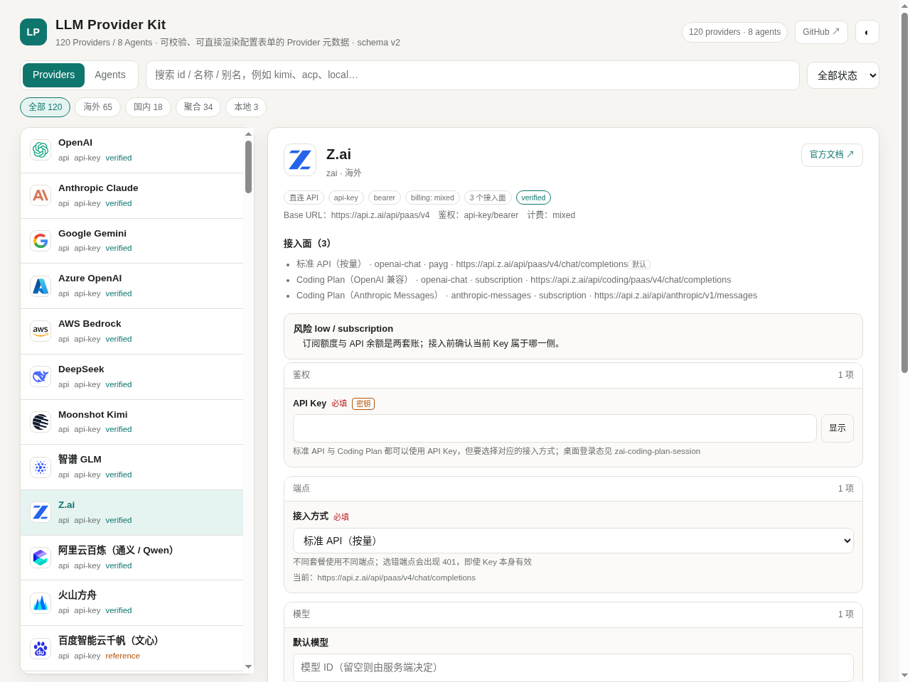

# llm-provider-kit

[English](README.md) · [简体中文](README.zh-CN.md) · [日本語](README.ja.md) · **한국어** · [Español](README.es.md) · [Français](README.fr.md)

AI 앱, Agent 패널 또는 게이트웨이에 Provider 설정 화면을 추가하려는 개발자를 위한 LLM 제공자 및 Agent 런타임 메타데이터 레지스트리입니다. 현재 **제공자 108개 / Agent 7개**, 의존성 없음, MIT 라이선스입니다.

## Demo

온라인 데모: <https://lawson2019.github.io/llm-provider-kit/>



## Agent 에게 전달할 프롬프트

아래 프롬프트를 코딩 Agent에 붙여넣으면 저장소를 클론하지 않고도 프로젝트에 맞는 Provider 설정 UI를 생성합니다.

```text
내 프로젝트에 LLM 제공자 설정 UI를 추가하세요. 저장소를 클론하지 마세요.

1. 먼저 다음 공개 리소스를 읽으세요:
   - Skill 가이드: https://raw.githubusercontent.com/lawson2019/llm-provider-kit/main/skills/llm-provider-kit/SKILL.md
   - 제공자 레지스트리: https://raw.githubusercontent.com/lawson2019/llm-provider-kit/main/data/providers.json

2. 프로젝트 기술 스택(React, Vue, Svelte, 바닐라 JS, 정적 HTML)을 판단해 그에 맞는 제공자 설정 화면을 생성하세요.

3. 화면에 다음을 포함하세요:
   - 제공자를 검색하고 전환할 수 있는 선택기;
   - 저장되거나 전송되지 않는 Key / 시크릿 입력란;
   - 제공자별 엔드포인트 선택(요금제, 리전, 프로토콜);
   - 레지스트리에서 도출한 인증 헤더;
   - 시크릿을 마스킹한 요청 미리보기;
   - ?provider= / ?agent= 파라미터로 여는 딥링크.

4. 각 제공자가 정의한 필드만 렌더링하고 제공자, 엔드포인트, 상태 라벨을 임의로 만들지 마세요.
```

## 생성되는 것

생성 UI는 React · Vue · Svelte · 바닐라 JS · 정적 HTML 다섯 가지 스택을 지원합니다. 포함 내용:

- **제공자 전환**: 전체 레지스트리를 검색하는 선택기;
- **계층 뷰**: Starter / Mainstream / Full 계층으로 그룹화;
- **인증 헤더**: 레지스트리의 인증 방식에 따라 자격 증명 첨부;
- **요청 미리보기**: 조립된 URL과 헤더, 시크릿 마스킹;
- **딥링크**: `?provider=` / `?agent=` 로 특정 제공자나 Agent 열기.

## 링크

- [providers.json](https://raw.githubusercontent.com/lawson2019/llm-provider-kit/main/data/providers.json)
- [agents.json](https://raw.githubusercontent.com/lawson2019/llm-provider-kit/main/data/agents.json)
- [tiers.json](https://raw.githubusercontent.com/lawson2019/llm-provider-kit/main/data/tiers.json)
- [SKILL.md](https://raw.githubusercontent.com/lawson2019/llm-provider-kit/main/skills/llm-provider-kit/SKILL.md)
- [Skill 디렉터리](skills/llm-provider-kit)
- [기여 가이드](docs/contributing.md)
- [License](LICENSE)

## License

MIT. 브랜드 이름과 로고는 각 소유자에게 귀속됩니다.
