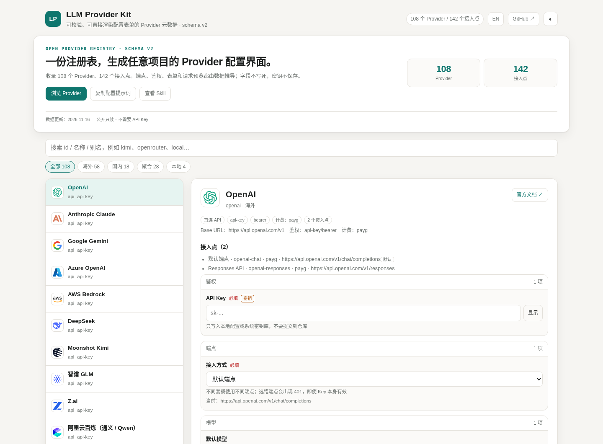

# llm-provider-kit

[English](README.en.md) · [简体中文](README.md) · [日本語](README.ja.md) · **한국어** · [Español](README.es.md) · [Français](README.fr.md)

LLM 프로바이더의 메타데이터 레지스트리로, 순수 JSON으로 제공되며 런타임 의존성이 없고 MIT 라이선스입니다. AI 앱, 코딩 어시스턴트 또는 게이트웨이에 프로바이더 설정 화면을 추가하려는 모든 사용자를 대상으로 합니다. **프로바이더 108개, 엔드포인트 142개**를 수록합니다.

각 프로바이더 항목은 자체 엔드포인트, 인증 방식, 폼 필드, 쿼터 메타데이터를 가지며, 해당하는 경우 위험 플래그를 표시합니다.

## Demo

라이브 데모(English / 中文): <https://lawson2019.github.io/llm-provider-kit/>



## 코딩 어시스턴트에게 전달할 프롬프트

아래 프롬프트를 임의의 코딩 어시스턴트에 붙여넣으면 프로젝트에 맞는 프로바이더 설정 UI를 생성합니다. 저장소를 클론할 필요는 없습니다.

```text
내 프로젝트에 LLM 프로바이더 설정 UI를 추가하세요. 저장소를 클론하지 말고 아래 공개 URL만 가져오세요.

1. 먼저 manifest를 읽으세요. manifest의 현재 버전, 항목 수, 정규 리소스 URL을 기준으로 삼으세요. Pages URL을 우선 사용하고 raw.githubusercontent.com을 대체 경로로 사용하세요:
   - https://lawson2019.github.io/llm-provider-kit/manifest.json

2. Skill 가이드를 읽고 필드 매핑, 인증 헤더 규칙, 엔드포인트 해석, 시크릿 마스킹, 요청 미리보기 규칙을 확인하세요:
   - https://lawson2019.github.io/llm-provider-kit/skills/llm-provider-kit/SKILL.md

3. manifest에 나열된 레지스트리 데이터를 가져오세요:
   - 프로바이더: https://lawson2019.github.io/llm-provider-kit/data/providers.json
   - 티어: https://lawson2019.github.io/llm-provider-kit/data/tiers.json
   - 스키마: https://lawson2019.github.io/llm-provider-kit/schemas/provider.schema.json
   Pages URL이 실패하면 https://raw.githubusercontent.com/lawson2019/llm-provider-kit/main/<상대 경로>를 사용하세요.

4. 내 프로젝트의 스택(React, Vue, Svelte, 바닐라 JS, 또는 정적 HTML)을 판단하고 그에 맞는 프로바이더 설정 화면을 생성하세요.

5. 화면에 다음을 포함하세요:
   - 프로바이더를 검색하고 전환할 수 있는 선택기.
   - 저장되거나 전송되지 않는 Key / 시크릿 입력란.
   - 프로바이더별 엔드포인트 선택. 레지스트리가 정의한 엔드포인트와 필드만 사용하세요(프로토콜, baseURL, 경로, 과금 방식, 그리고 해당 프로바이더 고유 필드). 레지스트리가 정의하지 않은 요금제나 리전 선택기는 추가하지 마세요.
   - 레지스트리에서 도출한 인증 헤더. 엔드포인트 수준 규칙을 프로바이더 수준 방식보다 우선 적용하세요.
   - 시크릿을 마스킹한 요청 미리보기.
   - ?provider=<id>를 사용한 딥링크. ID는 providers.json에서만 가져오세요.

6. 각 항목이 정의한 필드만 렌더링하고 프로바이더, 엔드포인트, 티어, 필드, 상태 라벨을 임의로 만들지 마세요. 완료하기 전에 프로바이더와 엔드포인트 수를 manifest와 대조하세요. 다르면 빈자리를 채우지 말고 멈춰서 불일치를 보고하세요.
```

## 생성되는 것

생성된 UI는 다섯 가지 스택——**React · Vue · Svelte · 바닐라 JS · 정적 HTML**——을 지원하며 다음을 포함합니다:

- **프로바이더 전환**: 전체 레지스트리를 검색할 수 있는 선택기를 제공합니다.
- **티어**: Starter(12), Mainstream(37), Full(전체 108).
- **인증 헤더**: 레지스트리의 인증 방식에 따라 자격 증명을 첨부합니다.
- **요청 미리보기**: 조립된 URL과 헤더를 보여주며 시크릿은 마스킹합니다.
- **딥링크**: `?provider=`로 특정 프로바이더를 엽니다.

## 링크

- [GitHub 저장소](https://github.com/lawson2019/llm-provider-kit)
- [manifest.json](https://lawson2019.github.io/llm-provider-kit/manifest.json)
- [llms.txt](https://lawson2019.github.io/llm-provider-kit/llms.txt)
- [providers.json](https://raw.githubusercontent.com/lawson2019/llm-provider-kit/main/data/providers.json)
- [tiers.json](https://raw.githubusercontent.com/lawson2019/llm-provider-kit/main/data/tiers.json)
- [provider.schema.json](https://lawson2019.github.io/llm-provider-kit/schemas/provider.schema.json)
- [SKILL.md](https://raw.githubusercontent.com/lawson2019/llm-provider-kit/main/skills/llm-provider-kit/SKILL.md)
- [Skill 디렉터리](skills/llm-provider-kit)
- [설치 및 사용](docs/install.md)
- [기여 안내](docs/contributing.md)
- [라이선스](LICENSE)

## 라이선스

MIT. 브랜드 이름과 로고는 각 소유자에게 귀속됩니다.
